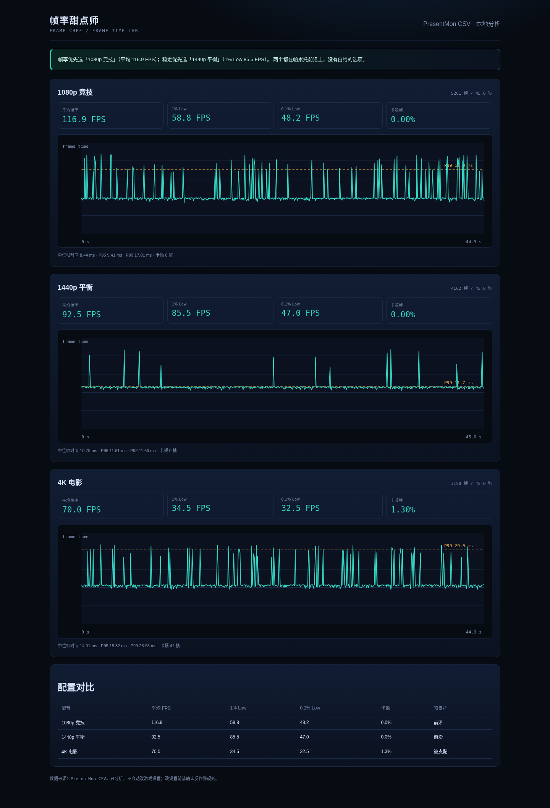

# 帧率甜点师 · Frame Chef

把 **PresentMon 的帧时间 CSV** 翻成一张能看懂的配置对比报告：平均帧率只是开场，真正决定“跟不跟手”的是 **1% Low、0.1% Low 和卡顿帧**。

不是又一个“跑分数字大就赢”的工具。它会在你给出的几个画质配置里，标出帕累托前沿，告诉你哪个是“帧率优先”，哪个是“稳定优先”。



## 为什么需要它

平均 120 FPS 的游戏，可能每 10 秒卡一下；平均 90 FPS 的游戏，反而更顺。只看平均帧率会把这种差别抹平。

`frame-chef` 读取 PresentMon 的逐帧数据，计算：

- 平均 FPS
- **1% Low**：最慢的 1% 帧对应帧率（按 P99 帧时间折算）
- **0.1% Low**：最慢的 0.1% 帧
- 中位 / P95 / P99 帧时间
- 卡顿帧比例（帧时间超过中位数 2 倍，且超过 25 ms）
- 每个配置的帧时间曲线
- 多配置的帕累托前沿与两条建议

## 快速开始

需要 Python 3.9+，只依赖标准库。

```bash
git clone https://github.com/QKXWX/frame-chef.git
cd frame-chef

python -m venv .venv
. .venv/bin/activate        # Windows: .venv\Scripts\activate
pip install -e .
```

分析一份采集：

```bash
frame-chef analyze examples/demo-captures/1080p-competitive.csv \
  --label "1080p 竞技" \
  --out report.html
```

比较三个配置：

```bash
frame-chef compare \
  examples/demo-captures/1080p-competitive.csv \
  examples/demo-captures/1440p-balanced.csv \
  examples/demo-captures/4k-cinematic.csv \
  --labels "1080p 竞技,1440p 平衡,4K 电影" \
  --out compare.html
```

不加 `--open` 不会弹浏览器；报告就是一个离线 HTML，直接双击也能看。

### 演示数据说明

`examples/demo-captures/` 里的 CSV 是 `examples/make_demo.py` 生成的**合成数据**，用来演示指标和报告长什么样，不是真实游戏采集。真实使用时按下一节自己采。

## 采集真实数据（Windows）

`frame-chef` 本身跨平台，只负责分析 CSV；采集需要 Windows 上的 [PresentMon](https://github.com/GameTechDev/PresentMon/releases)。

1. 下载 PresentMon，把 `PresentMon.exe` 放进 PATH。
2. 先开游戏，再运行：

```powershell
.\tools\capture.ps1 -ProcessName "game.exe" -Seconds 60 -Out "capture.csv"
```

3. 把 `capture.csv` 拿回任意机器分析。

`tools/capture.ps1` 是模板，不同 PresentMon 版本的参数可能略有差异。先跑 `PresentMon.exe --help` 确认；脚本里也做了短参数回退。

### 支持的 CSV 列

优先读 `msBetweenPresents`，没有就退到 `msBetweenDisplayChange`、`msUntilNextFrame`；时间列优先 `TimeInSeconds`，没有就用帧时间累加。UTF-8 BOM 和常见列名大小写都能处理。

## 报告怎么读

- **1% Low 比平均帧率更接近体感**：它代表最慢的那一小撮帧。1% Low 和平均差距越大，越容易觉得“顿”。
- **0.1% Low 看极端卡顿**：编译着色器、场景切换、后台占用往往会在这里露馅。
- **卡顿帧**：超过中位帧时间 2 倍且超过 25 ms 的帧，计入卡顿比例。
- **帕累托前沿**：如果配置 A 的平均 FPS 和 1% Low 都不比 B 差，且至少一项更好，B 就被支配。前沿上的配置才是真正需要取舍的选项。
- **两条建议**：`帧率优先` 取平均 FPS 最高；`稳定优先` 取 1% Low 最高。两者可能是不同配置，报告会直接写出来。

## 设计边界

- **只分析，不自动改游戏设置**。不注入、不挂钩、不改注册表，避免反作弊误判。
- **本地运行**。不上传采集数据，报告是纯静态 HTML。
- **不替代专业评测**。它读的是 PresentMon 的呈现帧数据，不包含 GPU 频率、功耗、温度；这些要另外看。
- **合成演示数据已标注**，避免把 demo 当真实成绩。

## 开发

```bash
python -m pytest -q
python -m ruff check .
```

测试覆盖指标计算、空数据/缺列、帕累托比较和 HTML 输出。

## License

MIT © 2026 QKXWX
